<div align="center">

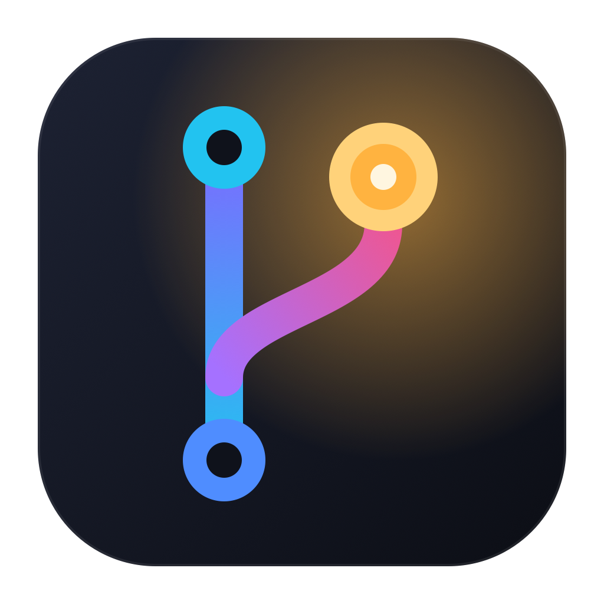

# Branchlight

**A fast, beautiful Git client for macOS.**

As light as Fork. As pretty as GitKraken. Free, open source, no account needed.


[](LICENSE)

[Features](#-features) · [Install](#-install) · [Shortcuts](#%EF%B8%8F-keyboard-shortcuts) · [How it works](#-how-it-works) · [ภาษาไทย](#-ภาษาไทย)

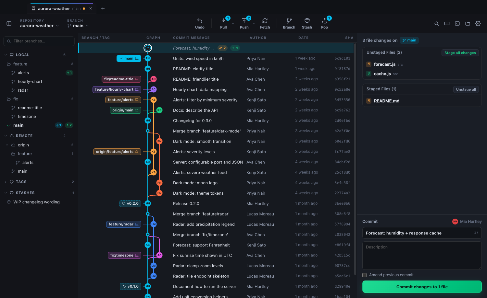

</div>

---

## Why Branchlight?

**Fork** is fast and does everything right, but it looks plain. **GitKraken** is gorgeous, but it is heavy, needs an account, and gates features behind a subscription. Branchlight combines what each does well:

| | Fork | GitKraken | **Branchlight** |
|---|:---:|:---:|:---:|
| Colourful lane graph with avatars | – | ✅ | ✅ |
| Line-by-line staging | ✅ | ✅ | ✅ |
| Works offline, no sign-in | ✅ | – | ✅ |
| Uses *your* git (hooks, SSH, GPG just work) | ✅ | – | ✅ |
| Free for private repos | ✅ (trial nag) | – | ✅ |
| Open source | – | – | ✅ MIT |

- ⚡ **Light.** The UI is about 110 KB of vanilla JS with **zero runtime dependencies**. The commit list is virtualised and the graph is drawn on a canvas, so long histories scroll smoothly.
- 🎨 **Beautiful.** It has a dark-first theme (light and system themes too), colour-coded lanes, initials avatars, and branch pills joined to their commits.
- 🔒 **Local.** No telemetry, no accounts, no cloud. Avatars are generated on the device, so even Gravatar is never contacted.
- 🧑‍💻 **No Apple Developer account.** Build and run it yourself with Node.

## ✨ Features

### 🌈 Commit graph
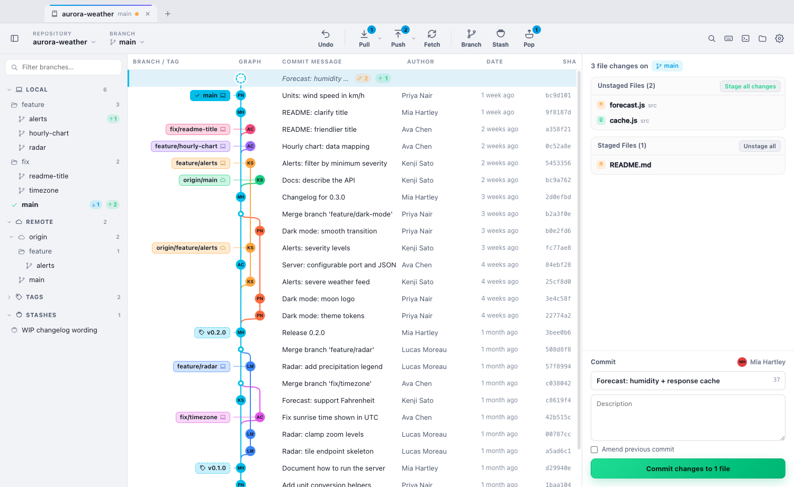

- Every branch gets its own colour. Merges curve in and out, and the graph reuses free lanes so it stays narrow.
- **Branch and tag pills** sit next to their commits. 💻 marks local and ☁️ marks remote, and a branch that matches its upstream shows as one pill.
- A **`// WIP` row** at the top shows uncommitted changes as a dashed node, with counts of modified and new files.
- **Find** (⌘F) dims everything except matching messages, authors or SHAs. ↩ / ⇧↩ jumps between matches.
- Double-click a commit's branch pill to check it out. Right-click for everything else.

### 🧩 Commit details
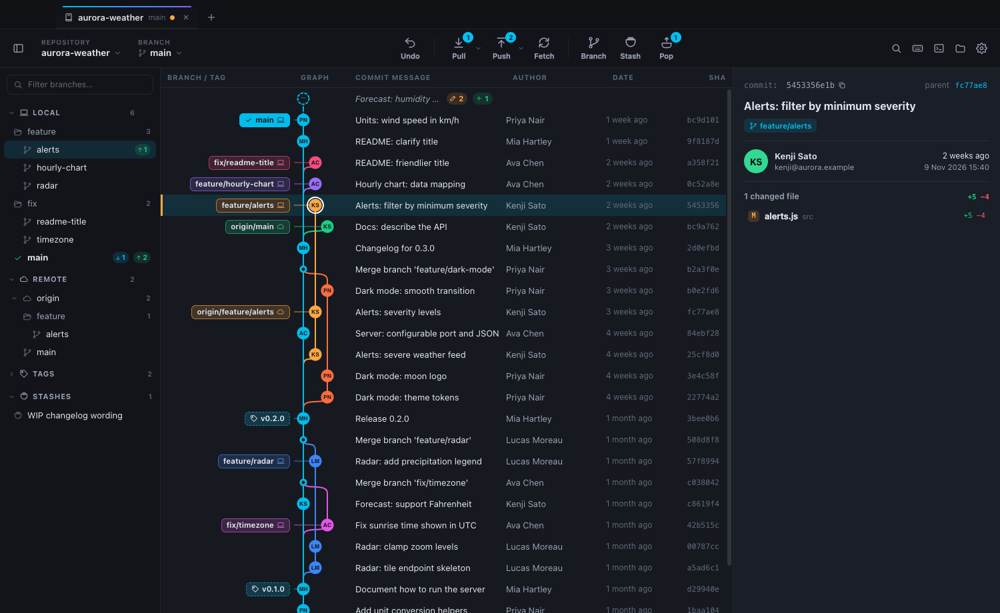

The panel shows the author, date, parents (click to jump), body, refs, and the changed files with +/− counts. A right-click on a file opens **File History**, **Open in Editor** or **Reveal in Finder**.

### 🔍 Diff viewer: unified or split, with word highlights
| Unified | Split |
|---|---|
| 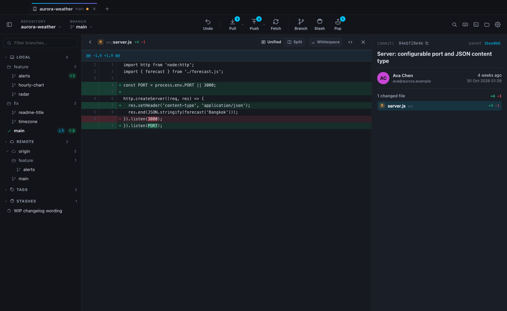 | 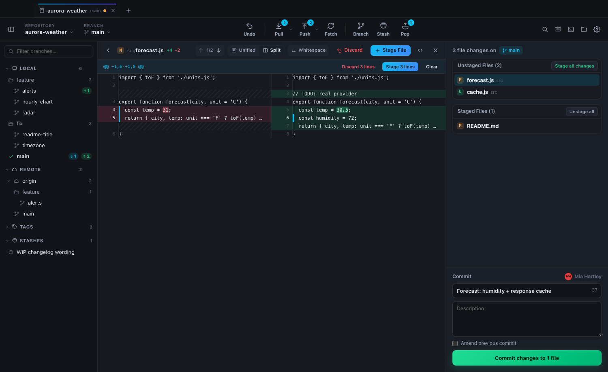 |

The changed words inside each line are highlighted. There is an ignore-whitespace toggle and an adjustable number of context lines, plus before/after previews for **images** (PNG, JPG, GIF, WebP, SVG).

### ✂️ Stage hunks or single lines
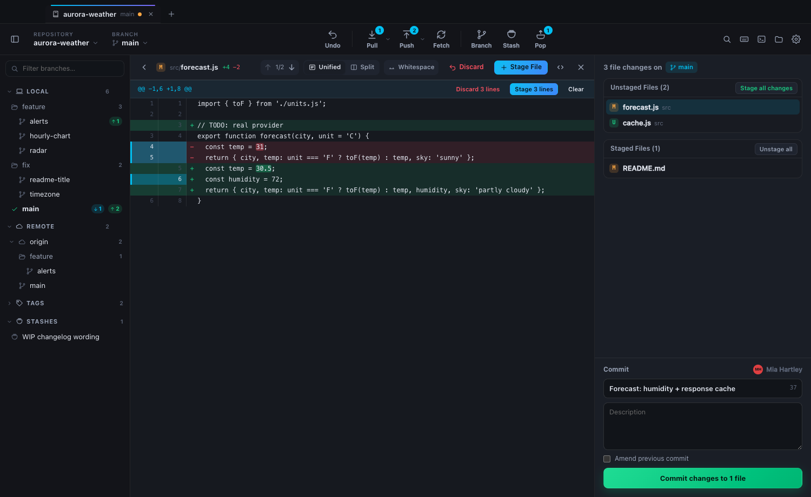

Click line numbers to pick lines (⇧-click for a range), then **Stage 3 lines**. The same works for **Unstage** and **Discard**, per hunk or per selection. Branchlight builds the patch and pipes it to `git apply`, the same thing `git add -p` does.

### 🧯 Merge conflicts without fear
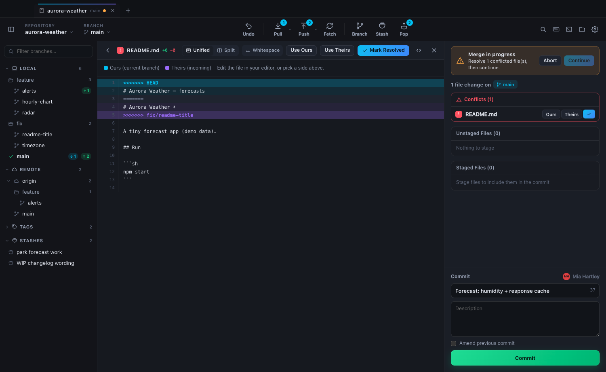

A banner shows the merge, rebase, cherry-pick or revert in progress, with **Abort** and **Continue** buttons. Conflict markers are colour-coded as *ours* and *theirs*. You can **Use Ours**, **Use Theirs**, or edit the file and press **Mark Resolved**.

### ⌨️ Command palette
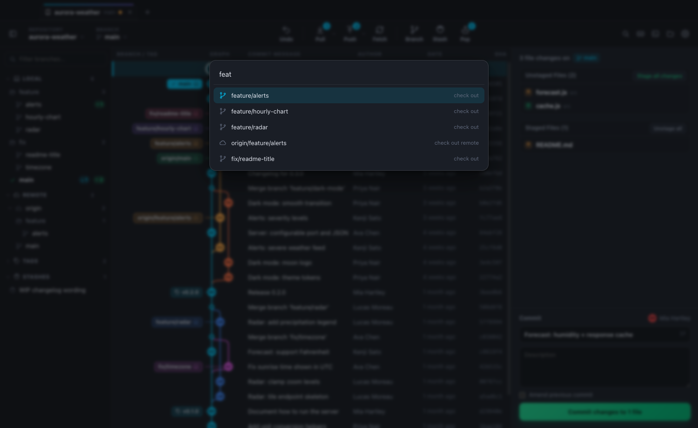

**⌘K** fuzzy-finds branches to check out, recent repositories and every command.

### 🖱️ Everything is a right-click away
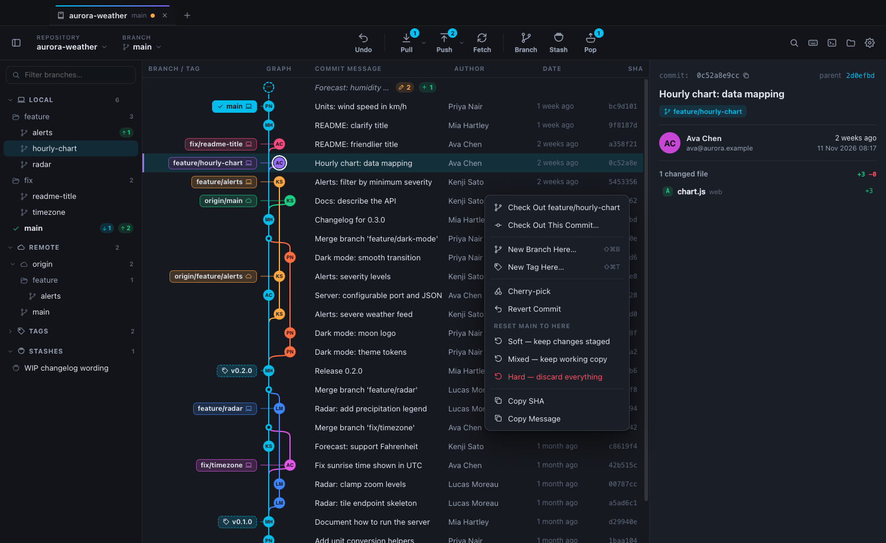

### And also
| | |
|---|---|
| **Tabs** | Open several repositories side by side. Tabs are restored on launch. |
| **Branches** | Create, rename and delete (locally and on the remote). Set upstream, see ahead/behind badges, and spot `gone` upstreams. Folders like `feature/*` show as a tree. |
| **Checkout** | Local, remote (creates a tracking branch) or detached. If your changes block the switch, **Stash & Switch** carries them over. |
| **Merge / Rebase** | `--no-ff`, `--squash`, rebase onto, cherry-pick, revert (including merges). |
| **Reset** | Soft, mixed or hard, each with a plain explanation. **Undo** removes the last commit and keeps its changes staged. |
| **Stash** | Stash with a message, optionally keeping the index. Apply, pop (restores the staged state) or drop. Preview a stash like a commit. |
| **Remote** | Fetch all (with prune). Pull as merge, rebase or ff-only. Push with automatic `-u` on the first push, force-with-lease, or push tags. |
| **Tags** | Lightweight or annotated. Push and delete. |
| **Commit** | 50/72 summary counter, description, amend (pre-fills the last message), and ⌘↩ to commit. |
| **Live refresh** | FSEvents watches the working tree and `.git`, so changes from your editor or terminal show up immediately. |
| **Clone / Init** | Clone with live progress, or start a new repository with `main`. |
| **Shortcuts out** | Open the repo in Terminal, Finder or VS Code. |

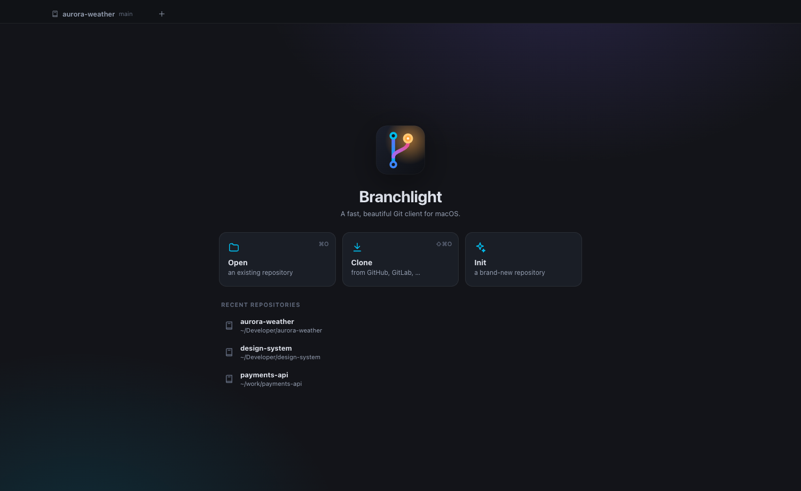

## 📦 Install

Requirements: macOS 11+, [Node.js](https://nodejs.org) 18+ and git (`xcode-select --install` or Homebrew).

```bash
git clone https://github.com/pucksaeroi-beep/branchlight.git
cd branchlight
npm install
npm run install-app      # builds Branchlight.app and copies it into /Applications
```

The app isn't code-signed (no Apple Developer account needed). The first time, **right-click → Open** in Finder, or run:

```bash
xattr -dr com.apple.quarantine /Applications/Branchlight.app
```

### Try it on a demo repository

```bash
npm run demo             # creates ./demo/aurora-weather with fake history, branches, tags,
                         # a stash, local changes, a remote that is ahead, and a ready-made conflict
npm start                # then ⌘O → demo/aurora-weather
```

Everything in the demo is made up (people, e-mails and project).

### Develop

```bash
npm run dev     # Vite + Electron with hot reload
npm test        # parsers, graph layout, and patch building against real git
```

## ⌨️ Keyboard shortcuts

| Action | Keys | | Action | Keys |
|---|---|---|---|---|
| Command palette | ⌘K | | Fetch | ⇧⌘F |
| Find commit | ⌘F | | Pull | ⇧⌘L |
| Local changes | ⌘1 | | Push | ⇧⌘P |
| Commit | ⌘↩ | | New branch | ⇧⌘B |
| Stage all / Unstage all | ⇧⌘A / ⇧⌘U | | New tag | ⇧⌘T |
| Open repository | ⌘O | | Stash / Pop | ⇧⌘S / ⌥⇧⌘S |
| Clone | ⇧⌘O | | Refresh | ⌘R |
| New tab / Close tab | ⌘T / ⌘W | | Toggle sidebar | ⌥⌘S |
| Switch tab | ⌥⌘1…9 | | Open in Terminal | ⌥⌘T |
| Move in graph | ↑ ↓ PgUp PgDn | | Close diff / find | Esc |

## 🔧 How it works

```
┌────────────── Renderer (sandboxed, vanilla JS) ──────────────┐
│ graph.js   canvas lanes + virtual list                       │
│ panel.js   commit details / stage & commit                   │
│ diff.js    unified · split · word diff · line staging        │
└──────────────────────┬───────────────────────────────────────┘
                       │ contextBridge: window.bl.git.op('stage', …)
┌──────────────────────▼───────────────────────────────────────┐
│ main.cjs   allow-listed operations only (no raw shell)       │
│ git.cjs    execFile('git', args) + pure parsers              │
└──────────────────────┬───────────────────────────────────────┘
                       ▼
                 your git CLI  ← credentials, SSH agent, hooks, GPG, LFS
```

- **The git CLI does the work**, as in Fork. Nothing is re-implemented, so behaviour matches the terminal exactly. Your login-shell `PATH` is loaded so that husky, lint-staged and git-lfs hooks work.
- **The renderer cannot run arbitrary commands.** It can only request named operations (`stage`, `merge`, `push`, …). Ref names starting with `-` and paths containing `..` are rejected, and paths always come after `--`.
- **No prompts can hang.** `GIT_TERMINAL_PROMPT=0` and `GIT_EDITOR=true` are set, so a missing credential or editor gives a readable error instead of a frozen app.
- **The graph layout** (`src/lib/graph.js`) is a single pass over `git log --date-order`. Each lane waits for a parent SHA, lanes join when they meet that commit, and freed lanes are reused.

### Project structure

```
electron/
  main.cjs        window, menu, IPC allow-list, FSEvents watcher
  git.cjs         git runner + parsers (status v2, log, refs, diff, numstat)
  preload.cjs     window.bl API
src/
  main.js         tabs, toolbar, welcome, palette, settings
  app.js          Repo state + op() runner
  actions.js      branch/merge/rebase/stash/push dialogs + context menus
  views/          graph · sidebar · panel · diff
  lib/            graph layout · patch builder (pure, unit-tested)
scripts/
  demo-repo.mjs   mock repository generator
test/             node --test
```

## 📄 License

[MIT](LICENSE) © 2026 pucksaeroi-beep

---

## 🇹🇭 ภาษาไทย

**Branchlight** เป็นโปรแกรม Git แบบมีหน้าตา (GUI) สำหรับ Mac ที่ตั้งใจให้ **เบาและเร็วแบบ Fork** แต่ **สวยแบบ GitKraken**

- 🌈 **กราฟ commit หลากสี** แต่ละ branch มีสีของตัวเอง และมีป้าย branch/tag ต่อเส้นไปยัง commit
- ✂️ **เลือก stage ได้ทีละบรรทัด** คลิกเลขบรรทัดเพื่อเลือก (กด ⇧ ค้างเพื่อเลือกเป็นช่วง) แล้วกด Stage จะ Unstage หรือ Discard ทีละ hunk ก็ได้
- 🔍 **ดู diff แบบ unified และ split** ไฮไลต์คำที่เปลี่ยนในบรรทัด และดูรูปภาพก่อนและหลังเทียบกันได้
- 🧯 **แก้ conflict ง่าย** มีแถบบอกว่ากำลัง merge หรือ rebase อยู่ พร้อมปุ่ม Abort และ Continue แล้วเลือก Ours, Theirs หรือ Mark Resolved ได้
- 📦 **stash, branch, tag, merge, rebase, cherry-pick, revert และ reset ครบ** คลิกขวาที่ commit, branch หรือไฟล์แล้วเลือกได้เลย
- 🔁 **Stash & Switch** ถ้าสลับ branch ไม่ได้เพราะมีงานค้าง แอปจะ stash ให้ สลับ branch แล้วเอางานกลับมาให้อัตโนมัติ
- ⌨️ **⌘K** ค้นหาแล้วสลับ branch, เปิด repo หรือสั่งคำสั่งใดก็ได้
- 🗂️ เปิดหลาย repo พร้อมกันเป็น**แท็บ** และหน้าจอรีเฟรชเองทันทีเมื่อไฟล์ในโปรเจกต์เปลี่ยน
- 🔒 **ทำงานในเครื่องทั้งหมด** ไม่ต้องสมัครบัญชี ไม่มี telemetry และรูปโปรไฟล์ก็สร้างจากตัวอักษรย่อในเครื่อง
- 🧑‍💻 **ไม่ต้องมี Apple Developer account** build เองด้วย Node ได้เลย

### ติดตั้ง

```bash
git clone https://github.com/pucksaeroi-beep/branchlight.git
cd branchlight
npm install
npm run install-app      # build แล้วคัดลอก Branchlight.app ไปไว้ใน /Applications
```

ครั้งแรกให้คลิกขวาที่แอปแล้วเลือก **Open** (เพราะแอปไม่ได้ลงลายเซ็นของ Apple)

อยากลองโดยไม่แตะ repo จริง ใช้ `npm run demo` เพื่อสร้าง repo ตัวอย่างที่มีประวัติ commit, branch, stash และ conflict ที่เตรียมไว้ให้ลอง (ข้อมูลทั้งหมดเป็นของปลอม)

Branchlight เรียก **git ที่ติดตั้งอยู่ในเครื่อง** โดยตรง SSH key, credential, hook และ GPG จึงใช้ได้เหมือนใน Terminal ทุกอย่าง
